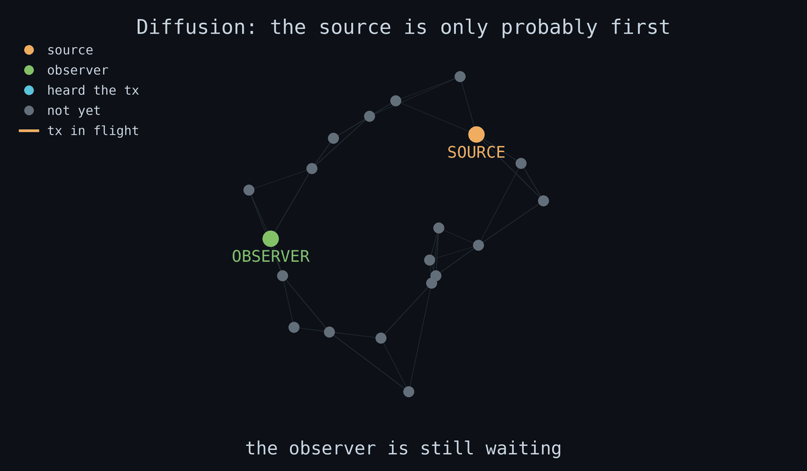
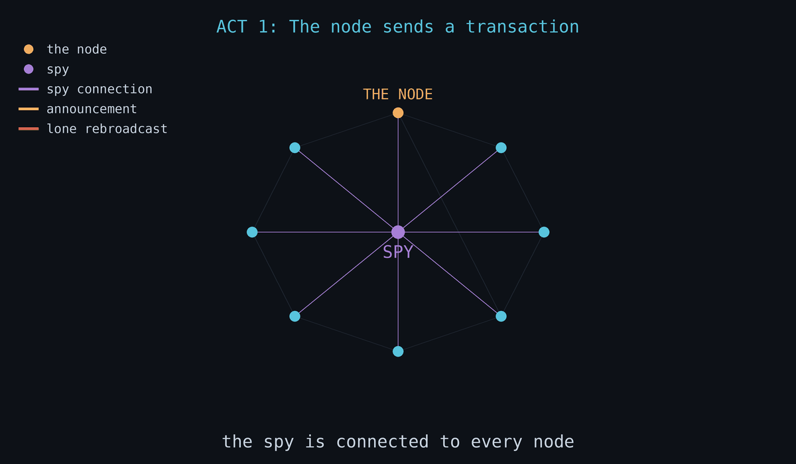
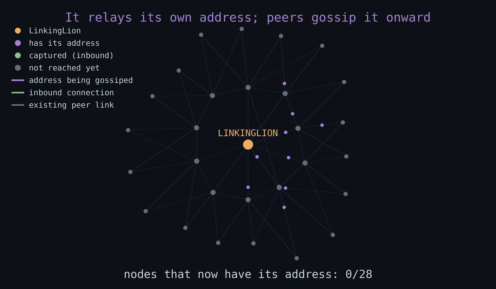
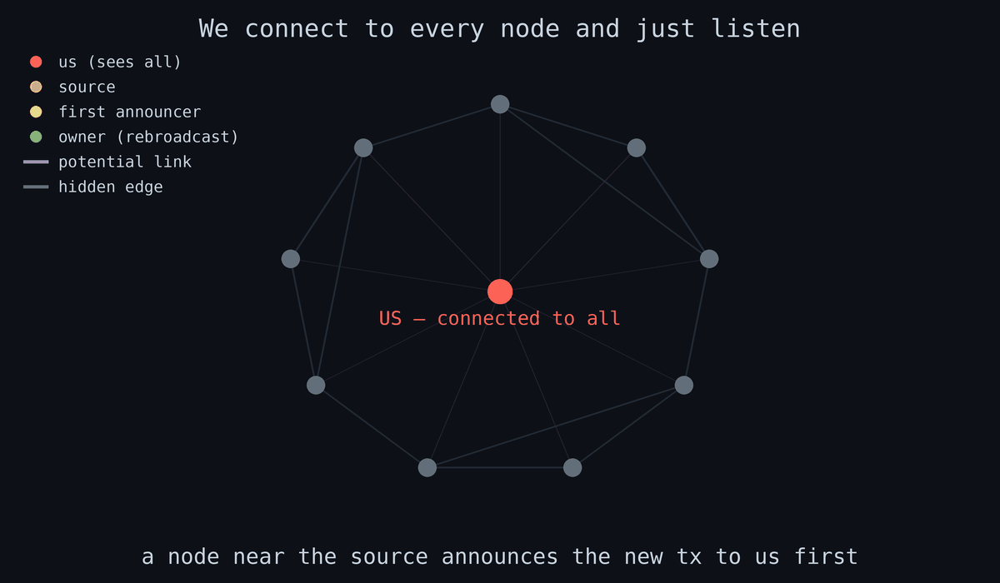
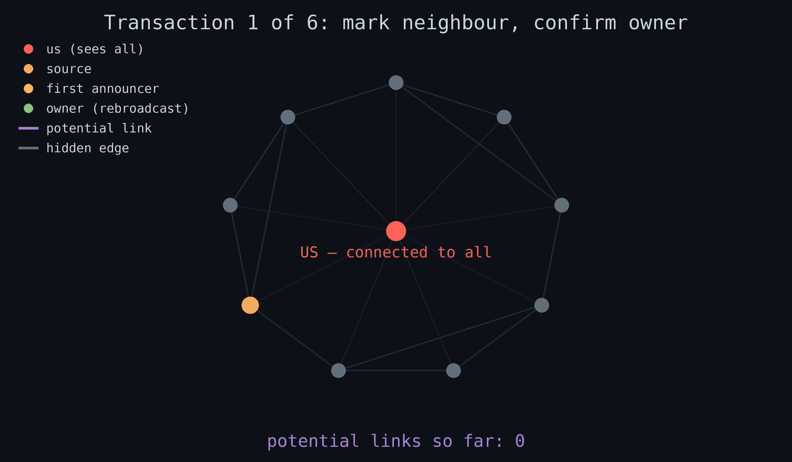

Full writeup: [reports/deanonymization.md](../reports/deanonymization.md) consolidates these
results (diffusion, NAT capture, wallet fingerprinting), the measured (weak) topology-timing leak,
and the active double-spend probe that would sharpen it.

---

### Source-attribution lab: results

Regtest, dockerized Bitcoin Core (the lab now defaults to 32.1; these numbers are from a 31.1 run),
ground truth = our own transactions.

### Linking an on-chain address to a node

Diffusion defeats passive observation. Core announces each transaction to each peer on an
independent randomised Poisson timer, so the first node to tell you about a transaction is a fast
relay, not the source.

A direct peer of a node that *holds* the transaction is different: a wallet
re-announces an unconfirmed transaction it holds to peers that would not otherwise hear it, and no
relay does. Core's rebroadcast is not gated on the transaction being the wallet's own, so a node
re-announces transactions it *received* too.

The attack needs no trigger. Plant a small low-fee payment (sats just above dust) into a target
address; it will not confirm, so the controlling node's wallet resends it on its own 12-36h timer.
Connect a fresh peer to each candidate; the one that re-announces the planted transaction controls
that address. (In the lab we fast-forward the resend timer with `setmocktime`, which advances the
clock; it does not force a rebroadcast on demand.)

### Numbers (K=5 targets, 6 trials, 30 attributions per arm)

| arm | spy attribution | passive baseline |
|---|---|---|
| target rebroadcasts (attack) | 100% (30/30) | 0% |
| `-walletbroadcast=0` (defense) | 0% | 0% |

The passive baseline only ever sees the hub (the sender) announce, never the address-controlling
target. Random guess is 20%. The defense is the target not rebroadcasting its received transaction.

### What it enables: clustering

Each success links an on-chain address to a node IP. Combined with wallet fingerprinting (the
wallet software inferred from transaction construction), it clusters address to node to software
into a persistent map.

### Capturing non-listening nodes (300-node run)

Every crawler and the attribution lab above see only listening nodes. The non-listening majority is
behind NAT and never accepts inbound, so you cannot connect to it. To observe it, run listening
nodes and advertise our address so non-listening nodes dial out to us; they become our inbound peers
and the same attribution applies.

`network_sim.py` brings up a 300-node regtest network of real Core nodes (1 attacker, 104
listening, 195 non-listening with `-listen=0`) and measures this directly:

| | result |
|---|---|
| non-listening nodes captured | 195/195 (every one dialed the attacker) |
| listening nodes | 104, crawler-reachable; a single Core node connects to only ~8 (see below) |
| peak memory | ~16 GB RSS across 300 nodes (~50 MB/node), ~22 GB free throughout |

The 195 NAT'd nodes accept no inbound, so no crawler can reach them; they are visible only because
they learned the attacker's advertised address and dialed out. That is the entire point of running
listeners and advertising. A single Core node, by contrast, makes only ~8 outbound-full-relay
connections (`MAX_OUTBOUND_FULL_RELAY_CONNECTIONS`), so the attacker cannot enumerate the 104
listeners from one node; that is a parallel crawler's job (`src/harvest.py`), the opposite direction.

A lab artifact to disclose: all nodes share 127.0.0.1 (one netgroup), so Core's normal one-outbound-
per-netgroup addrman selection cannot spread connections here. We model "the node learned the
advertised address and connects to it" with an `-addnode` to the attacker; the connection direction
(NAT'd node to attacker, inbound at the attacker) is the real phenomenon, only the address learning
is shortcut. Memory is capped per node (`-dbcache=4 -maxmempool=5 -par=1`) and startup is batched
with a `MemAvailable` floor check so the run cannot exhaust the host.

### Node behaviour: who broadcasts what, and when

The same 300-node run originates real payments (4 wallet nodes, one payment every 8 s) and times how
fast each diffuses. Each broadcast reached the attacker in 0.5-7 s and a far non-listening node
in 2-14 s, with occasional longer tails. This is Core's diffusion: the origin and every relay
re-announce each transaction to each peer on independent Poisson timers (mean ~2 s to outbound peers,
~5 s shared across inbound peers), which is exactly the randomisation that defeats a single-vantage
first-spy estimator and why the attribution attack needs a *direct* peer of the holder. Wallet
rebroadcast runs on a far slower 12-36 h timer, which is why the attribution lab fast-forwards it
with `setmocktime` rather than waiting.

### Topology from timing: a weak, aggregate-only leak

Measured, and mostly a limit. One observer opens a relay connection to every node and records, per
transaction, the order nodes first announce it; hop-distance from the source is known. Run on real
regtest Core (relay forced down inbound vs outbound edges) and on the Hyperion simulator (sr-gi) at
2,000 nodes with the realistic mix.

| regime | source announced first | the order |
|---|---|---|
| relay via inbound, coupled (48 txs) | 100% | strict: first non-source is always a 1-hop neighbour |
| relay via outbound, decoupled (48 txs) | 72% | noisy per tx; hop-order survives only on average |
| realistic mix, 2,000 nodes, 20 sources (Hyperion) | 40% | coarse: separates hops 0/1/2, blurs beyond |

In the realistic mix the average time-to-hear rises with hop-distance (hops 0-4: +2.3, +6.1, +8.3,
+8.7, +9.1 s) — a real aggregate signal — but weak: the source is first only 40% of the time, a
single transaction is nearly scrambled (one 80-node run put the source's 16 neighbours at ranks
1, 6, 9, 12, 13, 20, 23, 33, 45, 62-76), and it collapses past the first hop (2/3/4 land in one ~9s
cluster). A coarse near-vs-far bias, not source identification — matching the ~40% precision in the
timing-inference literature. `lab/topo_timing.py` (`REVERSE=0|1`).

Across 4 seeds / 80 Hyperion sims the **first** announcer is the source or a 1-hop neighbour in 79/80
(~99%) — but which is a ~40/60 toss-up and the **2nd** announcer is already ~45% two-hop. The 8-node
tree matches Hyperion on the 1st announcer but not the 2nd (76% vs 55% within one hop) — the tree has
2 nodes/hop vs Hyperion's hundreds, so it overstates the leak past hop 1. Source-first vs fanout
(`lab/star_fanout.py`): decoupled star 71% at 2 neighbours → ~50-57% at 8-16, the direction of
Hyperion's 40% (small-sample residual, not an exact match).

### Making it deterministic: active conflict probing

Passive timing is a noisy average. An active probe removes the noise: broadcast a transaction and a
conflicting double-spend (same input, two txids). Core accepts the first a node sees and, verified in
the source, does not relay a non-RBF conflict (relayed only on `MempoolAcceptResult::VALID`; the
conflict is rejected in validation). The network partitions into "saw A" / "saw B" camps along a
propagation-fixed boundary the observer reads directly (each node announces one txid); flooding the
conflict from every connection the instant the original appears freezes the still-original region to
the source plus its first hop or two. This is TxProbe's mechanism (first-seen-wins is sticky).

Building the conflict needs the input's key, so it is free for your own probe txs; reaching someone
else's needs third-party malleability, which modern Bitcoin has mostly closed — witness is outside
the txid (SegWit), legacy scriptSig malleations are non-standard (`LOW_S`/`CLEANSTACK` policy), and
only non-default sighash (`ANYONECANPAY`, appending a free pay-to-anchor `TxoutType::ANCHOR` input;
`NONE`/`SINGLE`) stays malleable, a small minority of traffic.

Measured (`lab/partition.py`): observer inbound to every node of an 8-node graph; flooding the
conflict at the same instant as the original froze the still-original region to the **source + 0.6
hops mean** (source alone in 3/5 trials) — deterministic, versus the passive order's ~40%-at-scale
guess. Malleability claims reproduced on Core 32.1 by `lab/malleate.py`: ANYONECANPAY append reuses
the victim's on-wire signature verbatim (`reuse=True`, accepted); SIGHASH_ALL does not (`reuse=False`);
`decodescript 51024e73 → type=anchor`, spent with no signature; segwit txid ≠ wtxid.

**Two-node plant vs flood.** Planting the conflict at one candidate peer instead of flooding: on the
8-node tree (`lab/planted_peer.py`) the source-camp grows with plant distance (2.3-5.0 nodes), but
Hyperion with first-seen-wins conflict modelling added (`run_conflict_sweep`, 2,000 nodes) shows it is
a coarse ~half-network bisection at scale (source-camp 31-43% regardless of plant hop; neighbour recall
0.6-0.8 but **~3% precision**). The flood isolates the source (±0.6 hops); one two-node plant maps
nothing at scale.

**Edge inference / certainty.** Orphan-based edge probing (TxProbe) needs a **normal-fee** parent —
low-fee resolves only via a 1p1c package, which requires parent+child from the *same* peer
(`GetChildrenFromSamePeer`), so a seeded child + network-delivered parent never combines; normal-fee
hits `AddChildrenToWorkSet` (announcer-agnostic) and resolves cross-peer. Orphans now have no time
expiry (per-peer weight eviction, 404,000 wU). The orphan detects but doesn't confine (the parent
floods); a binary edge test needs conflict confinement + the `INV`→`GETDATA` mempool oracle — no false
positives, false negatives decay with rounds, but loud and DoS-rate-limited. Not yet measured. The
through-line: certainty comes from target-exclusive behaviour (wallet rebroadcast → 0% false
positives), never from propagation timing.

### Wallet fingerprint

`detect_wallet` (Ishaana Misra) labels the wallet from construction heuristics. On regtest with
ground truth = Bitcoin Core, 3/3 Core transactions were identified as Bitcoin Core (one narrowed to
Bitcoin Core|Electrum, since the two share anti-fee-sniping, low-r, and RBF). A hand-built
`locktime=0` transaction was classified away from Core/Electrum, confirming the detector responds
to construction. This is the "what wallet" half of the clustering map.

### Signet validation

The observe-then-fingerprint path runs on the real network. A Core 31.1 node synced to public
signet (height 327,594, 10 peers), an observer connected over the real P2P protocol (signet magic
`0a03cf40`), and wallet fingerprinting of a live-mempool sample (about 101 of 120 txns classified,
mostly automated-looking, a handful Ledger|Trezor-class). Prevouts come from the UTXO set via
`gettxout(..., include_mempool=false)`, so no `-txindex` is needed.

### Implementation notes

- A planted tx is only rebroadcast once it is at least 5 min older than the best block
  (`wtx.nTimeReceived <= m_best_block_time - 5*60`), so we mine an empty block 10 min ahead in
  mock time, keeping the tx unconfirmed.
- A +36h mock-time jump evicts already-connected peers, so we jump the clock first, then connect
  the fresh spies, then step the clock in small increments so the shared inbound inv timer flushes.

### Limitations

- The attribution lab uses a small star topology; the 300-node run adds scale, a listening/non-
  listening split, a connected backbone, and live payment traffic.
- The method identifies a node that *holds* the transaction in a wallet. We plant into the target,
  so it is the receiver. Whether a node's own outgoing transactions identify it the same way was
  not tested.
- Dockerized stock Core (the lab now defaults to 32.1; these runs used 31.1). The defense is modelled
  with `-walletbroadcast=0`, which disables rebroadcast. Private broadcast is not exercised; in
  current Core the wallet rebroadcast ignores it anyway (bitcoin/bitcoin#3828, bitcoin/bitcoin#36403).
- Listening nodes only, unless the inbound-capture method above is used.

### Reproduce

    docker build --build-arg VER=32.1 -t deanon-lab lab/
    docker run --rm -v $PWD:/work -w /work/lab -e PYTHONPATH=/work/src deanon-lab \
        python3 rebroadcast_experiment.py
    # 300-node capture + diffusion run (args: N listen_frac settle_seconds)
    docker run --rm -v $PWD:/work -w /work/lab -e PYTHONPATH=/work/src deanon-lab \
        python3 network_sim.py 300 0.35 75          # -> results/network_sim_300.txt
