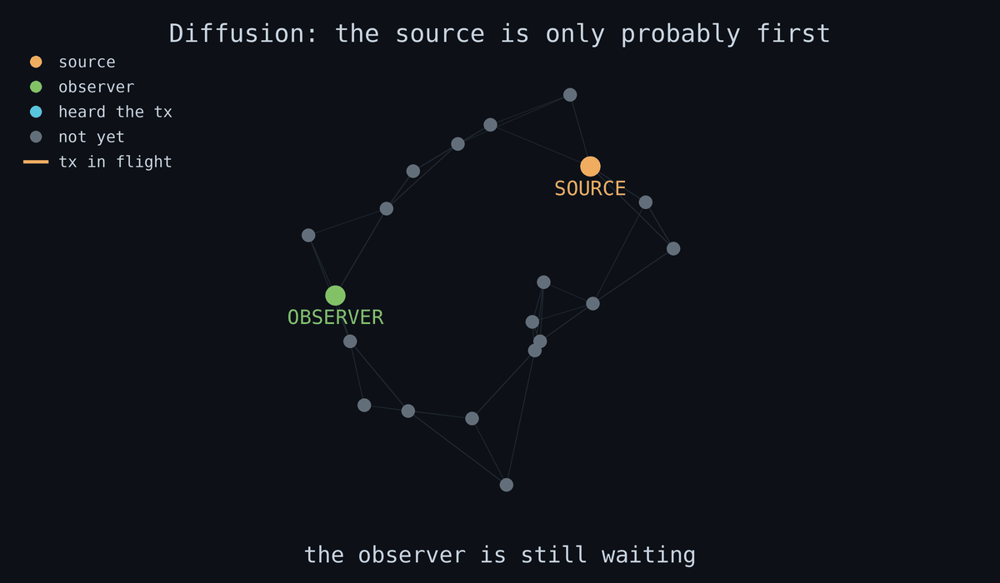
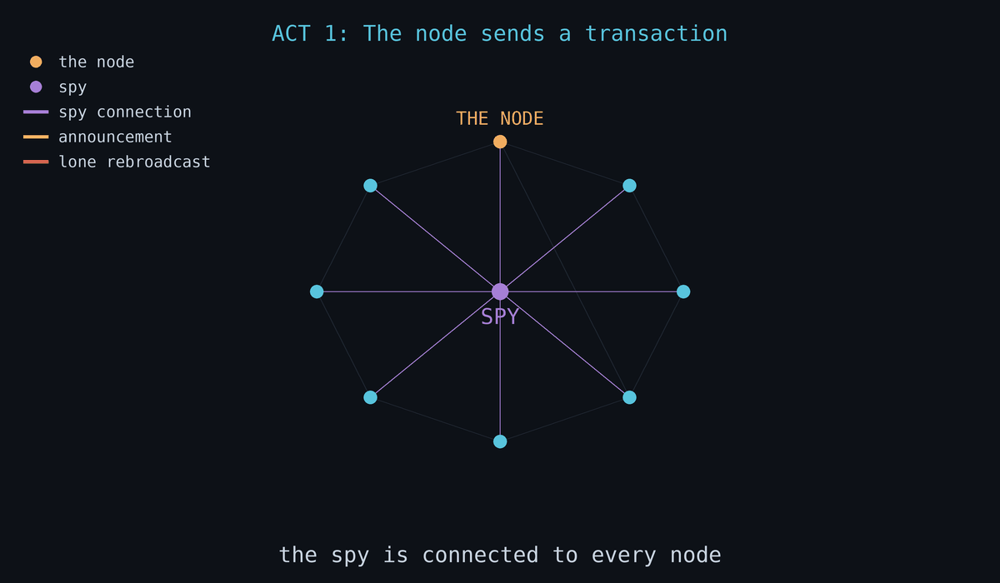
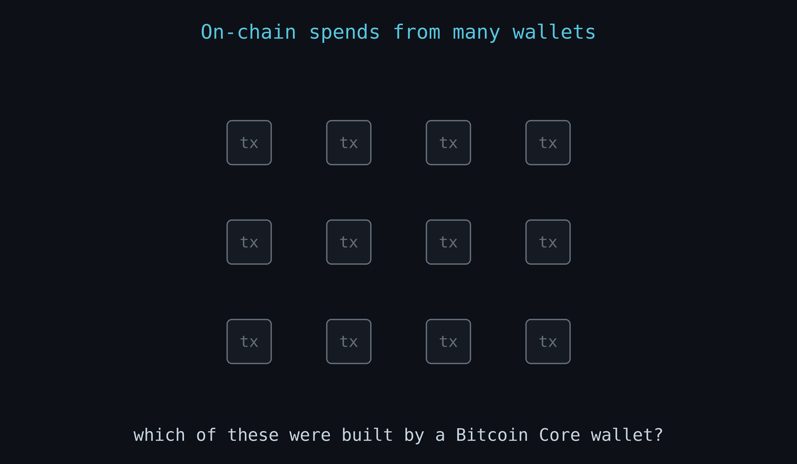
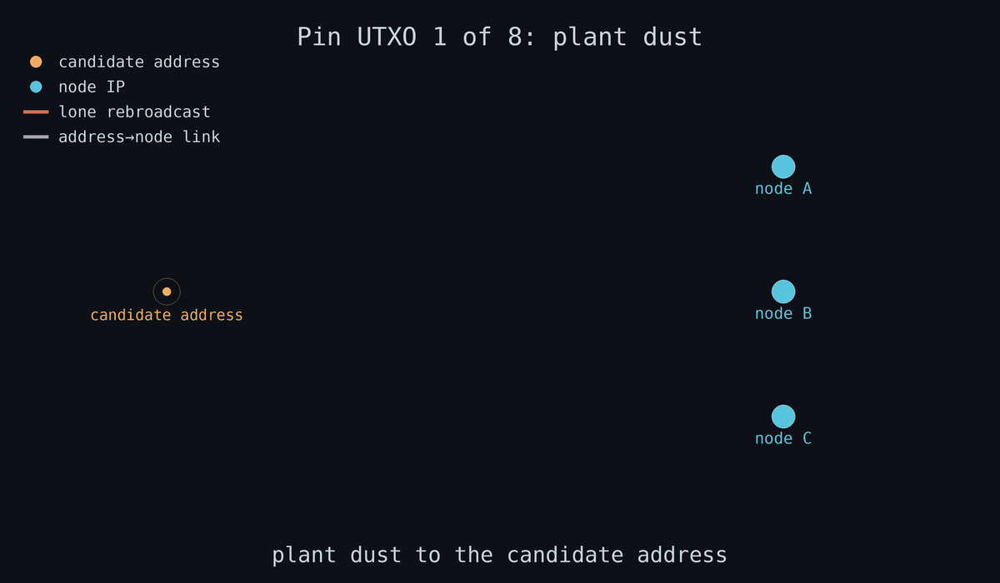
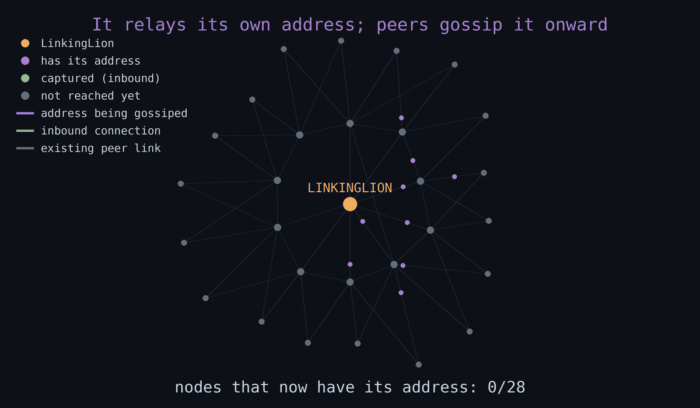
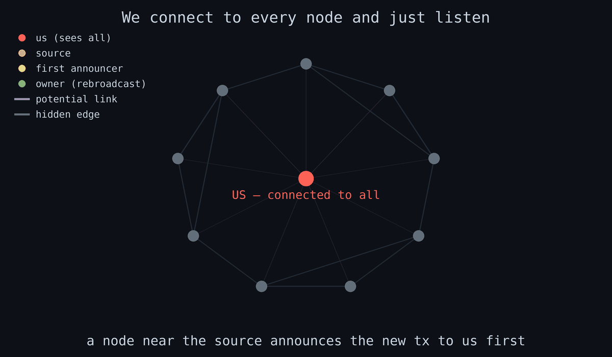
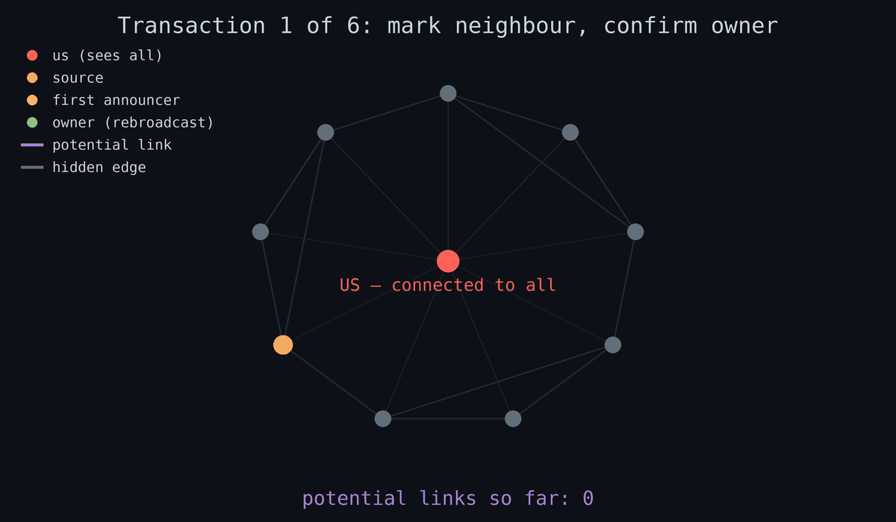

## Exploiting Transaction Rebroadcast to discover IP and More

### Introduction

Deanonymizing a transaction and learning its source is possible, but existing methods often give only
probabilistic attribution. See [0xB10C's LinkingLion writeup](https://b10c.me/observations/06-linkinglion/).
A first-spy observer gets a biased, noisy guess: Core announces to outbound peers on a ~2s timer and to
inbound peers on a shared ~5s timer, and because those are different clocks a LinkingLion-style observer
cannot know the source with certainty. Poisson timers blur the signal.

*Why passive timing attribution is only probabilistic: Poisson announcement timers (per-peer outbound, shared inbound) mean the source is only probably-first.*

The LinkingLion variant is passive. The active Bitcoin Core wallet rebroadcast gives a stronger attack. The
rebroadcast is a deterministic signal, and in our tested configurations we linked the address to the node
whose wallet tracks it 100% of the time. That holds under a few preconditions: the target runs a Core wallet
with rebroadcast on (`-walletbroadcast` default true), the planted tx is accepted and stays unconfirmed and
eligible, the attacker holds a connection on which it can see the announcement, and the attacker can tell a
wallet rebroadcast apart from ordinary relay. This post simulates it on regtest and on a fork of sr-gi's
Hyperion, revisits topology discovery to measure how much it leaks, and suggests mitigations. All experiments
ran on regtest and a simulator; nothing was measured on mainnet.

### What the attacker needs

The attacker knows a candidate on-chain address, can build and broadcast a tx paying it, can run one or
more listening Bitcoin nodes, can connect to candidate nodes (or attract their outbound connections), can
observe P2P tx announcements, and is willing to wait out the 12-36h rebroadcast.

It does not need access to the victim's machine or wallet, private keys, cooperation from the victim, or a
high-fee transaction. That is what makes it serious.

### Linking an address or UTXO to the node tracking it

This is a long-known leak, not a new one (bitcoin/bitcoin#3828, now bitcoin/bitcoin#36403). A wallet
re-announces an unconfirmed transaction it holds, whether sent or received, to peers after it stays in the
wallet unconfirmed for 12-36h.

By passively listening an adversary may link IPs to addresses. Passively waiting for a victim's own payment
to stay unconfirmed that long is rarely useful, since most transactions carry enough fee to confirm well
before the 12-36h window.

The active version plants a small payment into a confirmed address, sending a new transaction to an
already-used address from a confirmed UTXO, paying an output of at least the dust threshold. It is unlikely
to confirm quickly, so the tracking node's wallet resends it on its own 12-36h timer. (The wallet only
resends a transaction received more than five minutes before its last chain-tip notification. Core skips any
tx with `wtx.nTimeReceived > m_best_block_time - 5min`, so an eligible one has `nTimeReceived <= m_best_block_time - 5min`,
where `m_best_block_time` is the wall-clock time the wallet saw a new tip rather than the block's own
timestamp.) Planting into several addresses at once works because each planted payment goes to a distinct target address,
so the spy matches each planted txid to the node that announces it; this was run with 5 targets at a time.
Other unconfirmed transactions in the victim's wallet don't interfere, since the spy just filters for the
planted txids. Connect a fresh peer to each candidate node, and the
node that re-announces a planted transaction is running a wallet that tracks that address.

This is recognition rather than key control. A watch-only wallet tracks an address without holding its key
(`IsMine` is script-membership only, with no key check), so the attack pins the node whose wallet recognizes
the address, which may not be the party that controls the funds. A relay does not re-announce an old mempool
transaction to a newly connected peer [^1].

In our tested configurations this was 100%. The periodic resend initiates a broadcast to transaction-relay
peers even while the planted tx is still in the node's mempool, and it takes the broadcast-to-all path
(`InitiateTxBroadcastToAll`) whether or not the tx was newly added. That is the behaviour #36482 would
change. Normal per-peer announcement suppression still applies, so a peer already told isn't told again, but
a freshly connected spy hasn't been told and receives the announcement. We ran this on regtest and read the
path on master (`4cf0f7c`, 2026-11-25) and the v32.1 branch; we did not run every released version.

*The planted tx and the wallet's lone rebroadcast 12-36h later, which pins the address to the node.*

### Simulating this on regtest

On regtest, a hub plants one such payment into each of K target wallets and a fresh spy connects to
each; over K=5 targets across 6 trials (30 attributions) the spy linked the address to the correct
node 100% (30/30) of the time, against 0% for a passive observer on the hub and a 20% random baseline. The
passive observer sits on the sending (hub) side, so it only ever sees the hub announce the planted tx. It
never sees which target node holds it, so it has no signal tying the address to a target and scores 0%.

The lab brings up stock Dockerized Bitcoin Core nodes on regtest. A hub node funds and plants the
low-fee payments; each target is a separate node whose wallet holds its planted payment unconfirmed. The
targets ran default Core descriptor wallets with keys (hot wallets via `createwallet`); a watch-only wallet
(`disable_private_keys=true`) would behave identically here, since `IsMine` and the resend path ignore keys.
A fresh P2P spy connects to each candidate and records every transaction it is told about, and the
candidate that announces a planted txid is the node whose wallet tracks it. A planted transaction only
becomes eligible for rebroadcast once its received time is at least five minutes before the wallet's last
chain-tip notification (`m_best_block_time`, set to wall-clock time on each new tip rather than the block's
timestamp), so the lab mines an empty block ahead in mock time, keeping the transaction unconfirmed, and
then steps the clock past the 12-36h resend window.

### Cost of the attack

The planted payment needs to relay but not confirm. The default minimum relay fee is 0.1 sat/vB
(`DEFAULT_MIN_RELAY_TX_FEE{100}` sat/kvB). The planted output must clear the dust threshold: 294 sats for
P2WPKH, 330 for P2TR, 546 for P2PKH (`DUST_RELAY_TX_FEE` stays at 3000 sat/kvB). Modelling each planted
transaction as one input and one output of the listed type (the vB depends on both, so 110 vB is a P2WPKH
input and P2WPKH output, not just a P2WPKH destination), a round of K=5 costs:

| Output type | vB | fee | dust | per-tx | round (×5) | gross value (USD) |
|---|---|---|---|---|---|---|
| P2WPKH | 110 | 11 sat | 294 | 305 sat | 1,525 sat | ~$0.90 |
| P2TR | 111 | 12 sat | 330 | 342 sat | 1,710 sat | ~$1.01 |
| P2PKH | 192 | 20 sat | 546 | 566 sat | 2,830 sat | ~$1.67 |

(USD at 1 sat = $0.00059, ~$59k/BTC, 25 Nov 2026. This column is the gross value exposed, before any RBF
recovery.) The relay fee is only 11-20 sats and the dust is ~95% of it, so a five-target round exposes
roughly $0.90 to $1.70 gross, about $0.18 to $0.33 per target. Under the RBF funding below the net cost
drops to mostly fees.

One tx per target: you can't batch all K targets into one txid if you want 1-to-1 address-to-node
attribution, since a batched tx only tells you which nodes are in the set, not which address each belongs to.

Whether the dust is actually lost depends on how you fund the plant. The simplest option funds each plant
from a UTXO pre-split to exactly dust plus fee, which is the minimal 1-in-1-out row in the table (110 vB for
P2WPKH). With exact funding the dust really is spent to the target, because a replacement paying yourself
back would be a sub-dust output and get rejected, so the gross figure is the real cost. To recover the dust
you fund from a larger UTXO so a replacement can return a non-dust output to yourself. After attribution you
RBF-cancel: the replacement has to beat the original's absolute fee and also pay for its own size at the
incremental relay feerate (`-incrementalrelayfee`, a separate parameter from the min-relay feerate though both default to 0.1 sat/vB), and only the replacement confirms.
You get the dust back and the net cost falls to about two relay fees per target at minimum, a few tens of sats, though actually getting the replacement mined costs whatever the current confirmation feerate is. The
change output back to yourself adds ~31-43 vB (+3-5 sats; 31 for P2WPKH, 34 for P2PKH, 43 for P2TR), and you
tie up more capital per target.

### Fingerprinting candidate UTXOs

[Wallet fingerprinting](https://ishaana.com/blog/wallet_fingerprinting/) reads the wallet software off a
transaction's construction: input ordering, change-output position, nVersion, locktime and anti-fee-sniping,
and so on. You don't have to scan every address. Cluster the on-chain spends, use the change heuristics to
guess which wallet made each one, keep the spends that look like a Core wallet, and plant only against those.

*Fingerprint on-chain spends by their construction and change heuristics, keeping only the likely-Core candidates.*

### Clustering reachable UTXOs across the network

The use of this deanonymization is clustering. Each hit gives an address-to-node association, and repeating
it across candidate UTXOs builds a map of which addresses were seen at which nodes. Node identity is not
proof of common ownership: one entity can run many nodes, and a node's wallet can track addresses it doesn't own (a watch-only server, an exchange, or a shared service).
So even if you never reuse an address, the map still reveals an address-to-node association, as long as you
stop short of calling same-node a single owner.

*Hits accrete into an address-to-node map; same-node is only an association.*

### Capturing non-listening nodes

Many non-listening nodes are behind NAT or otherwise unable to accept inbound connections, so you cannot
connect to them. To observe them, run listening nodes and advertise your address so non-listening nodes dial
out to you; they become your inbound peers and the same attribution applies. An entity with a wide, diverse presence (many
netgroups and ASes, LinkingLion-style) can probabilistically get more non-listening nodes to dial out,
increasing the number you can observe.

A node that runs on several networks at once rebroadcasts to all of them. The rebroadcast relays via
`InitiateTxBroadcastToAll`, which announces to every peer with no network filter. A node that reaches the
network over Tor or I2P for privacy but also keeps clearnet peers will re-announce the planted transaction
over clearnet too, leaking its clearnet IP. Only a node configured `-onlynet=onion` (or otherwise without
clearnet peers) avoids this; a dual-stack node does not.

*Attracting outbound connections so non-listening (NAT'd) nodes dial in to the attacker's listeners.*

### Transactions broadcast privately can be captured

Private broadcast does not protect against this, in two ways.

If the user sends a low-fee tx with `-privatebroadcast` and it sits unconfirmed for 12-36h, the periodic
resend falls back to `InitiateTxBroadcastToAll` and leaks it to all peers. The private path only covers the
first announcement; the rebroadcast ignores it.

If instead the privately-broadcast tx confirms immediately, or was pushed through a third-party node or Tor
pusher while the address is watched in a Core wallet, the attacker plants a new low-fee payment to an address
from that tx and waits for the Core wallet to rebroadcast the planted tx over `InitiateTxBroadcastToAll`.

### Affected software

The leak is in the Bitcoin Core wallet, and it fires on watch-only and hot wallets alike. `IsMine` checks
only whether the output script is in the wallet, not whether a private key is present, and the resend path
has no spendable-keys gate. So any software that loads its addresses into a Core wallet inherits the leak,
whether that is a watch-only wallet (`createwallet` with `disable_private_keys=true` plus
`importdescriptors`/`importmulti`) or a hot spending wallet.

We verified the mechanism in Core's own code. Which apps actually load their addresses into a Core wallet,
and so inherit it, is taken from each project's documented Core integration rather than from running each
one. Treat the list as "where to look", and confirm against your own version.

| Software | How it uses Core | Affected |
|---|---|---|
| Bitcoin Core / Knots | native descriptor wallet, `-walletbroadcast` default true | yes (Core tested) |
| Sparrow | Bitcoin Core ("Cormorant") mode only | yes |
| Specter Desktop | Core RPC, watch-only descriptor wallet | yes |
| Liana | bitcoind backend mode | yes |
| Fully Noded | Core RPC, `disable_private_keys` wallet | yes |
| Gordian Wallet | Core RPC, `importmulti` watch-only | yes |
| JoinMarket / Jam | Core watch-only wallet (user runs `createwallet` per docs) | yes |
| Lily Wallet (v1.0.7) | Core RPC, `importmulti` watch-only | yes |
| Electrum Personal Server | `importmulti` watch-only into Core | yes |
| Caravan (local bitcoind) | `importdescriptors` watch-only | yes |
| bwt (Bitcoin Wallet Tracker) | `createwallet` + `importmulti` watch-only | yes |
| Eclair | no internal on-chain wallet; uses a Core hot wallet | yes |

Not affected (own scanning, Electrum/Fulcrum, or compact-block-filter backends): LND, Core Lightning,
BDK apps / Bitcoin Safe, NBXplorer / BTCPay by default (only affected if the operator sets
`ImportKeysToRPC=true`), any wallet pointed at Fulcrum/electrs/Esplora, and Wasabi / neutrino CBF
wallets.

Notes: Sparrow is only affected in its Bitcoin Core connection mode; its Electrum mode is a separate,
unaffected path. JoinMarket's own app wallet holds keys, and it is affected because it also registers
addresses into a separate Core watch-only wallet. Lily's affected call is in the v1.0.7 tag; current
HEAD comments it out in a WIP refactor.

### Extending to topology discovery

*What the timing measures: the order in which nodes relay a freshly originated tx out from the known source.*

The rebroadcast already deanonymizes the source. The remaining question is whether watching the tx spread
also reveals the source's neighbours. Somewhat: it reveals the single likeliest neighbour, and little beyond
that.

The planted tx can't be reused here. Once you broadcast it the network already has it, so when the victim
rebroadcasts 12-36h later, peers that still hold it in mempool drop the inv and don't relay it further. So
this timing measurement applies to a freshly originated transaction from the now-known source, or a
rebroadcast of a tx that peers had previously evicted, rather than the already-in-mempool planted tx.

Simulate a fresh broadcast from the now-known source and watch it spread, with an observer that is inbound to
every node so it hears each node the first time that node announces. I measured this on a fork of sr-gi's
Hyperion, source taken as already known, seed 42, 200 runs per size:

| Graph (reachable / total) | 2nd announcer is within one hop | a ≥3-hop node beats a 1-hop node |
|---|---|---|
| 2,000 / 20,000 | 185/200 = 92.5% | 200/200 sims (100%) |
| 10,000 / 100,000 | 181/200 = 90.5% | 200/200 sims (100%) |

The second node we hear after the source is a direct neighbour ~90% of the time, and it held at both sizes we
ran (2,000 and 10,000 reachable), a decent "who's adjacent to the source" signal. It does not reconstruct the
neighbourhood, though. In every simulation some ≥3-hop node is heard before some 1-hop node, because the
shared 5s inbound-announcement timer flattens the hear-order. The ordering leaks hop-distance at the very top
but washes out below that, so you can flag the likeliest neighbour without being able to rank the source's
peers by timing. Reproduce: `./target/release/hyperion -r 2000 -u 18000 -s 42 -n 200 -l off 2>/dev/null | python3 analyze_ll.py` (and `-r 10000 -u 90000` for the second row).

The graph we built is synthetic. Every node makes 8 outbound connections to uniformly-random reachable nodes
(Hyperion's default), reachable nodes also take inbound, and non-listening nodes take none, so it is a
directed random 8-out graph with relay connections treated as undirected when computing hop distance. It is
not an Erdős–Rényi graph, where every edge is present independently with a common probability; here each node
picks a fixed eight. It is also not the real Bitcoin topology: mainnet has heterogeneous degree, long-lived
and manually-added peers, and AS and geographic clustering that a uniform-random graph doesn't capture, and
our observer being inbound to every node is an idealisation no real attacker gets for free. So the ~90% is an
empirical result for this model under favourable assumptions. It is not a measured mainnet rate, and two
sizes at 200 seeded runs with an ideal observer do not establish a bound on real Bitcoin topology. Nothing
here was measured on mainnet.

*Past the single likeliest neighbour the ranking breaks down: a ≥3-hop node beats a 1-hop node in every sim.*

### Mitigations

One way not to leak is to turn off wallet broadcasting. `-walletbroadcast=0` does more than stop the
rebroadcast: it disables all wallet-initiated relay. The wallet no longer announces your own new
transactions either (`CommitTransaction` returns before it even submits them to the mempool), so you would
have to relay them yourself. With the target's `-walletbroadcast=0` the spy drops to 0%, since the
rebroadcast is the only signal. Method and numbers are in
[lab/RESULTS.md](../lab/RESULTS.md).

That bluntness is because `-walletbroadcast` is one switch over two behaviours: the initial broadcast of your
own sends, and the periodic (re)broadcast of every unconfirmed tx the wallet tracks. The second is the leak.
Splitting them cleanly is a bit tricky, because the periodic path also fires on transactions the wallet only
received and never broadcast itself (the planted-payment case), so for those it is the first announcement
rather than a re-announcement. A workaround today is to keep `-walletbroadcast=0` and broadcast your own
sends through `sendrawtransaction`, which relays once via the node's `BroadcastTransaction` path (the same
one the RPC and the wallet both call) with no periodic resend. A cleaner fix would be a dedicated option for
the periodic (re)broadcast, which would still have to decide what to do about received transactions whose
only announcement would be that path.

bitcoin/bitcoin#36482 proposes only rebroadcasting a transaction that was
newly added to the mempool, which removes the signal for a planted transaction that stays in the mempool
(leaving the eviction path [^2]).

| Mitigation | privacy benefit | trade-off |
|---|---|---|
| `-walletbroadcast=0` | kills the rebroadcast signal | disables all wallet broadcasting, including the initial send of your own txs; you must relay them yourself |
| bitcoin/bitcoin#36482 (only rebroadcast a tx newly added to the mempool) | removes the signal for a planted tx that just sits in the mempool | a proposed PR, not released; does not eliminate every rebroadcast leak (the eviction path remains) |
| avoid Core watch-only/hot-wallet integration (own scanning / Electrum / CBF backend) | sidesteps this wallet behaviour entirely | needs a different backend architecture |
| `-onlynet=onion` / `-onlynet=i2p` | stops clearnet IP exposure even if rebroadcast stays on | still links the address to the node's onion/I2P identity; a dual-stack node is not protected |

bitcoin/bitcoin#36482 is a proposed patch, not deployed, and the attack was verified against current
released Core (v32.1 and master). It addresses this specific attack rather than source deanonymization in
general.

[^1]: A relay does not re-announce an old mempool transaction to a newly connected peer. The caveat: a small-mempool relay does not rebroadcast on its own, but if it evicts the planted tx and later receives the victim's rebroadcast, it treats the tx as new and re-relays it to its peers (including a spy), a false positive or secondary announcer.

[^2]: The eviction path that still leaks under #36482: if the planted tx is evicted from the victim's own mempool (for example under mempool pressure) and the wallet later resubmits it, that counts as newly added, so even the "only rebroadcast if newly added" rule rebroadcasts it again.
